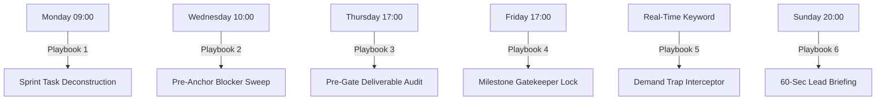

# Venture Studio Chief of Staff (Studio OS)

An autonomous operational engine and Antigravity Skill designed for venture studios, accelerators, and incubation programs. It operates as the proactive Chief of Staff for studio leadership, keeping founders accountable, deconstructing tasks, auditing deliverables, and intercepting premature engineering without requiring manual human oversight.

---

## 1. White-Label Configuration (`studio_config.json`)

To deploy this engine for any venture studio (e.g. Cybrdeck, Mamba Partners, Antler, Entrepreneur First):

```json
{
  "studio_name": "Cybrdeck Studio OS",
  "program_name": "12-Week MVP Venture Track",
  "timezone": "Asia/Singapore",
  "leadership": {
    "technical_leads": ["Gwen Lim", "Ben Lim"],
    "program_lead": "James Sun",
    "project_coordinator": "Arthur Andre Pandaan"
  },
  "communication_channels": {
    "platform": "slack",
    "leads_channel": "#studio-leads",
    "cohort_channels": ["#cohort-1", "#cohort-2"]
  },
  "core_protocol": "Pre-Build Demand Validation Protocol (WoZ)"
}
```

---

## 2. The 6 Core Proactive Autonomous Playbooks



### Playbook 1: Monday Morning Sprint Deconstruction (09:00 AM)
- **Schedule**: `0 9 * * 1` (Mondays at 09:00)
- **Objective**: Never let founders start a sprint in a fog. Decompose the weekly syllabus module into a concrete, 5-day numbered task checklist.
- **Action**:
  1. Pull current week syllabus module and milestone deliverable.
  2. Parse each founder's dossier and current traction status.
  3. Generate tailored Monday-to-Friday checklist and dispatch via DM.
- **Sample Output**:
  > *"Good morning, [Founder]. Sprint [X] Kickoff.*  
  > *Your core milestone due Friday 5 PM is [Weekly Deliverable]. Here is your tactical checklist for the week:*  
  > *1. Mon: Rank Top 10 Critical Assumptions.*  
  > *2. Tue: Launch manual WoZ test in localized cluster (Target: 3 paid transactions).*  
  > *3. Wed: Prep office hours blocker with leadership.*  
  > *4. Thu: Synthesize feedback scorecard.*  
  > *5. Fri: Submit Evidence Pack & KPI dashboard update."*

---

### Playbook 2: Wednesday Pre-Anchor Blocker Sweep (10:00 AM)
- **Schedule**: `0 10 * * 3` (Wednesdays at 10:00)
- **Objective**: Prevent 45 minutes of wasted small talk during Program Lead Office Hours.
- **Action**:
  1. Ping every founder 4 hours prior to Office Hours.
  2. Solicit their single biggest blocker, technical hurdle, or scope dispute.
  3. Compile and deliver a 1-page **Executive Blocker Dossier** to the Leadership leads.
- **Prompt**:
  > *"Office Hours with leadership are today at 2 PM. What is your #1 critical decision or bottleneck that needs locking today? Drop your update now so mentors review it before the call."*

---

### Playbook 3: Thursday Pre-Gate Deliverable Audit (05:00 PM)
- **Schedule**: `0 17 * * 4` (Thursdays at 17:00)
- **Objective**: 24-hour early warning system before Friday evaluation gates.
- **Action**:
  1. Query Supabase/storage for uploaded draft deliverables.
  2. Audit completion status.
  3. If unsubmitted, fire an assertive accountability alert.
- **Prompt**:
  > *"The Friday 5 PM Milestone Gate closes in 24 hours: [Milestone Deliverable]. Your submission is currently unverified. Are you submitting on time, or are we flagging an intervention?"*

---

### Playbook 4: Friday 5:00 PM Gatekeeper & Ledger Lock
- **Schedule**: `0 17 * * 5` (Fridays at 17:00)
- **Objective**: Lock the studio ledger and update cohort progress scorecards.
- **Action**:
  1. Lock deliverable submissions.
  2. Score completeness (Cleared / Conditional Pass / Intervention Needed).
  3. Update Supabase telemetry and emit alerts to the `#studio-leads` channel.

---

### Playbook 5: The "Pre-Build Demand Trap" Interceptor (Continuous / Reactive)
- **Trigger**: Inbound founder messages containing trigger terms:
  `["building backend", "coding the app", "setting up database", "microservices", "writing the code", "need 3 weeks to build"]`
- **Objective**: Ruthlessly protect studio engineering hours and enforce Wizard of Oz demand validation.
- **Execution**:
  > *"Halt. Pre-Build Protocol Intercept:*  
  > *You are trying to write code before validating willingness to pay. Cybrdeck rule: Show me the LOI, deposit, pre-payment, or completed manual WoZ test first. What proof do you have that customers want this?"*

---

### Playbook 6: Sunday Evening 60-Second Lead Briefing (08:00 PM)
- **Schedule**: `0 20 * * 0` (Sundays at 20:00)
- **Objective**: Keep studio leadership fully aligned without requiring status meetings.
- **Action**:
  1. Aggregate all founder check-ins, blockers, and gate scores from the past week.
  2. Synthesize an executive 3-bullet briefing:
     - 🚀 **Advancing**: Founders who hit transaction velocity.
     - ⚠️ **At Risk**: Founders sidetracked by premature architecture or missing deliverables.
     - 🎯 **Leadership Focus**: Specific founder interventions required for the upcoming week.
  3. Dispatched directly to `#studio-leads` and leadership DMs.

---

## 3. White-Label Deployment Guide

To deploy this engine for a new client or venture studio:

1. **Clone & Configure**:
   - Set environment variables (`SLACK_BOT_TOKEN`, `SLACK_APP_TOKEN`, `SUPABASE_URL`, `AI_API_KEY`).
   - Customize `studio_config.json` with the client's mentor names and syllabus schedule.
2. **Launch on Cloud Server**:
   - Run via Docker:
     ```bash
     docker run -d --name studio-chief-of-staff --restart always --env-file .env studio-cos
     ```
3. **Database Integration**:
   - Creates tables `knowledge_documents`, `founder_checkins`, and `studio_milestones` with `pgvector` enabled for complete institutional memory.
