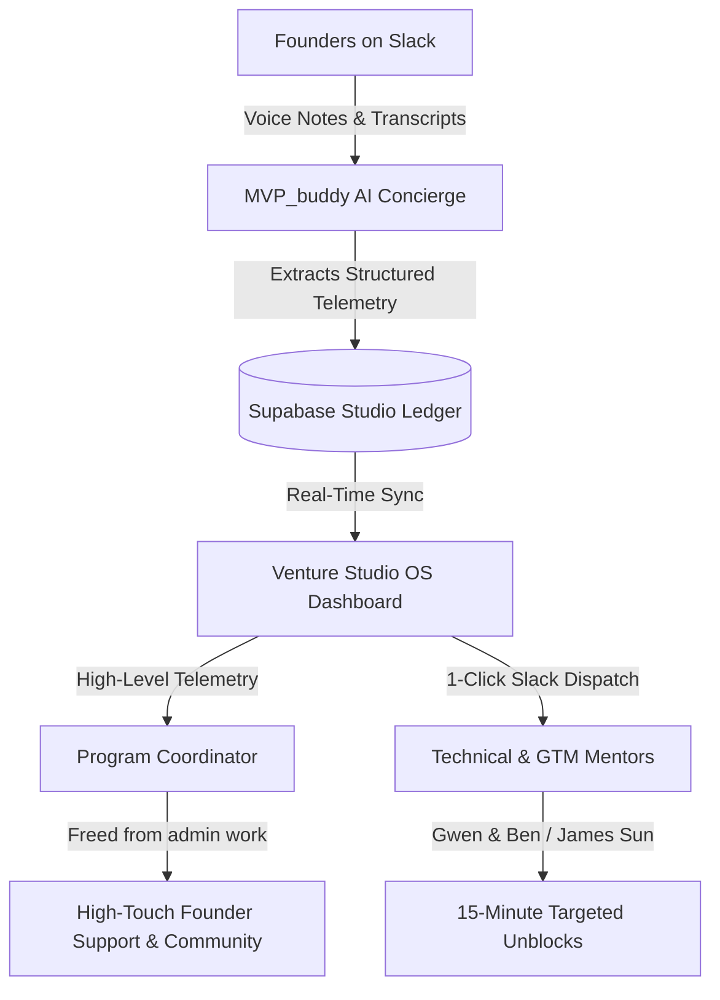

# Mamba MVP Program · Venture Studio OS

**An ambient command center and AI co-pilot designed to supercharge venture studio teams, program coordinators, and founders.**

[👉 View the Live Command Center](https://evecount.github.io/venture_dashboard/)

---

## 🎯 Purpose: Empowering Studio Teams & Program Coordinators

Traditional accelerators and venture studios drown in operational overhead: chasing weekly status reports, copying notes across disparate spreadsheets, and manually tabulating milestone deliverables. 

**Venture Studio OS** transforms this dynamic. By deploying an autonomous resident AI co-pilot (**`MVP_buddy`**), the platform eliminates administrative drudgery—freeing **Program Coordinators** to focus on what humans do best: high-touch founder relationship building, strategic advisory, community engagement, and partner management.

---

## ⚡ Core Platform Capabilities

### 1. Ambient Founder Telemetry (Zero-Form Ingestion)
* **No Manual Status Forms**: Founders never have to log into Jira, Asana, or rigid tracking software.
* **Conversational Slack Ingestion**: Founders drop natural voice memos, meeting transcripts, or quick text check-ins directly into Slack.
* **Autonomous Structuring**: `MVP_buddy` (powered by Qwen LLM) analyzes unstructured text and audio transcripts, extracting `Status`, `Stream`, `Progress Velocity`, and `Active Blockers` into a synchronized ledger.

### 2. Live Founder Roster ("Pokemon Cards") & 12-Week Sprint Trackers
* **Visual Identity Cards**: Each venture is presented with role badges (`Tech Architect` vs. `GTM Strategist`), lead mentors, current sprint moves, and active blockers.
* **12-Week Segmented Progress Bars**: Visual progress pips representing Weeks 1 through 12 of the program (`W1` to `W12`), with active velocity bars and pulsed blocker alerts.
* **Deep-Dive Dossiers**: 1-click inspection modal displaying founder thesis, target audience, stack tags, customer transcripts, and mentor advisories.

### 3. Pre-Build Demand Validation Protocol
* **Protecting Engineering Hours**: Enforces disciplined pre-build customer proof—verifying genuine customer demand and willingness-to-pay using manual concierge/spreadsheet validation before custom backend code is allocated.
* **Automated Compliance Auditing**: The AI cross-checks customer discovery interview transcripts against milestone criteria to ensure ventures build on validated customer problems.

### 4. 1-Click Outbound Slack Dispatch & Targeted Mentor Routing
* **Coordinator Hand-Off Flow**: The AI detects blocker types and pre-formats targeted unblock briefs for human mentors.
* **Direct Mentor Notification**: 1-click dispatch to technical leads (**Gwen Lim & Ben Lim · Cybrdeck**) for code/data unblocking and GTM leads (**James Sun · Mamba**) for value-prop reviews.
* **Leadership Broadcasts**: Instantly broadcasts cohort triage summaries and lead briefings to `#mamba-leads` or `#cybrdeck-leads`.

### 5. Multi-Cohort Workspace Management
* **Instant Cohort Provisioning**: `MVP_buddy` can provision entirely new cohorts (e.g. `SG#01`, `SG#02`) complete with newly minted founder rosters in seconds.
* **Seamless Workspace Switching**: Studio coordinators can toggle between active cohorts, geographic batches, and historical alumni from the top header selector.

### 6. Executive Synthesis & Rapid Action Chips
The resident AI concierge provides instant, high-signal operational briefings with clean, icon-free action chips:
* **`Cohort Triage`**: Scans cohort telemetry, identifies critical-path blockers, and suggests pair-programming or mentor interventions.
* **`Milestone Gate Check`**: Audits founder readiness against Friday gate deliverables (Venture Thesis & Top 10 Ranked Assumptions).
* **`Pre-Build Reality Check`**: Verifies that 100% of ventures are adhering to manual customer demand validation.
* **`60-Second Lead Briefing`**: Generates an executive pulse summary ready to paste directly into Slack or investor updates.
* **`Coordinator Hand-Off`**: Prepares rapid handover briefings so the coordinator can route founders to technical mentors with zero prep time.

### 7. Full Syllabus Timeline & Founder Completion Matrix
* **Comprehensive 12-Week Roadmap**: Details weekly phases from *Problem & Founder Thesis* to *Demo Day & Investor Showcase*.
* **Founder Completion Tracking**: A dedicated matrix column displays which founders have passed each milestone, which are in progress, and who has flagged blockers.
* **Activity & Office Hours Schedules**: Live tracking of syllabus exercises, fireside chats, and lead assignments.

---

## 👥 How the Studio Team Works Together

---

## 🛠️ Technology Architecture

* **Frontend**: React 19, TypeScript, Tailwind CSS, Lucide Icons, Vite SPA pipeline.
* **Backend & Telemetry**: Python `slack-bolt` bot running in Socket Mode, Supabase PostgreSQL database.
* **AI Engine**: Qwen Plus LLM (via OpenAI-compatible API) enforcing studio system prompts and structured JSON extraction.
* **Deployment**: GitHub Pages static bundle pipeline with zero-latency client state.

---

**Built by Cybrdeck for the Mamba MVP Program.**  
*Zero friction. Zero clicking. Pure execution.*
